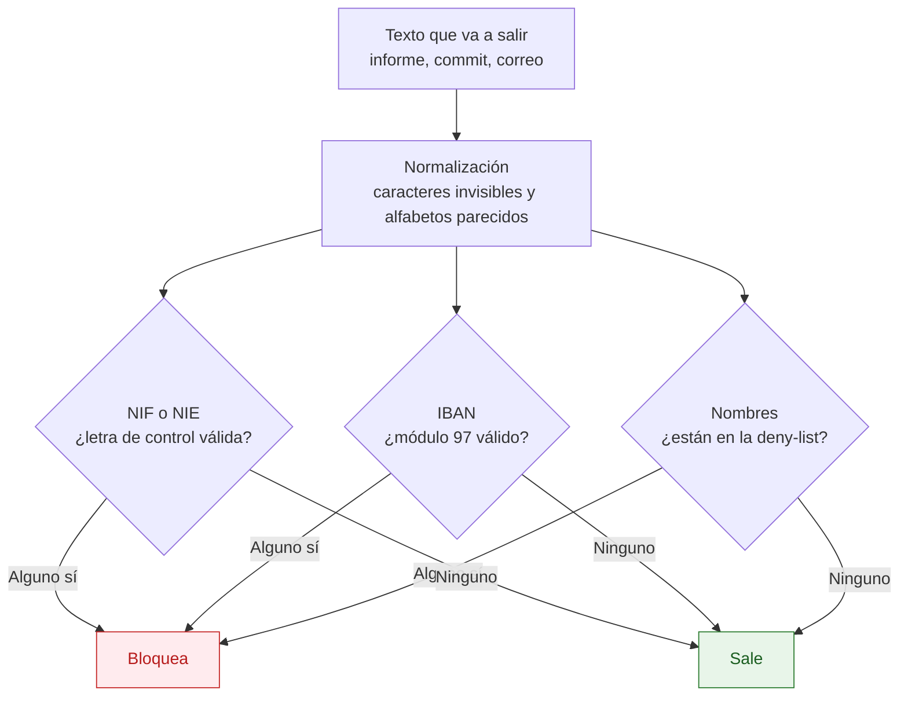

English version: [README.en.md](README.en.md)

# pii-output-gate

[](https://github.com/jleonceo/pii-output-gate/actions/workflows/ci.yml)

**Una puerta de salida para agentes de IA: lo que lleva datos personales no sale.**

Sin dependencias (solo Python estándar), sin base de datos, sin IA, sin red.

## Qué resuelve

Un agente de IA que trabaja con datos reales acaba, tarde o temprano, publicando algo: un informe, un
commit, un correo, un fichero.

Este proyecto nace de un escape real. Un agente publicó unas nóminas después de sustituir los nombres
por `EMP001` y `EMP002`. Las dio por limpias. No lo estaban. Seudonimizar no es anonimizar: cambiar el
nombre por un código no borra el dato, lo disfraza, y el resto de la nómina sigue ahí para deshacer el
disfraz. Y no había nada detrás que lo parase.

Eso es lo que hay aquí: un candado en la puerta de salida que no depende de que el modelo se porte bien.
Da igual lo bien escrito que esté el prompt. Si en lo que va a salir hay un DNI válido, la puerta
no se abre.

## El ejemplo

```
Texto limpio                                   -> DEJA SALIR
DNI valido (letra correcta)                    -> BLOQUEA   clases: nif
Nombre de la deny-list, tal cual               -> BLOQUEA   clases: nombre_denylist
El mismo nombre partido por un salto de linea  -> BLOQUEA   clases: nombre_denylist
El mismo nombre con acento cambiado            -> BLOQUEA   clases: nombre_denylist
IBAN de ejemplo del estandar, con guiones      -> BLOQUEA   clases: iban
```

Los tres casos del medio son el motivo de que esto exista. Un buscador ingenuo caza el primero y se le
escapan los otros dos: para él, `Fulano Menganez` partido en dos líneas ya no es `Fulano Menganez`.

Fíjate también en el mensaje de bloqueo: dice la clase de dato, no el dato. **El log de un detector de
PII no puede filtrar PII.**

## Cómo funciona




Tres comprobaciones, ninguna adivina:

1. **NIF y NIE**: no basta con que el patrón encaje. Se valida la **letra de control** (módulo 23). Un
   `12345678A` con la letra que no toca no bloquea, porque no es un DNI: es un número.
2. **IBAN**: mismo criterio, se valida el **módulo 97** del estándar. Nada de bloquear cualquier cosa que
   empiece por ES.
3. **Nombres**: contra una deny-list que tú le pasas. Nunca se versiona: entra como parámetro.

Antes de comparar, el texto se normaliza a fondo: fuera los caracteres invisibles (la categoría Unicode
`Cf` entera, no una lista de unos cuantos) y se mapean los alfabetos que se dibujan igual que el latino.
Esa parte no es cosmética, es la que aguanta el red team.

Todo vive en `portero_pii.py`: normalización, NIF/NIE mod-23, IBAN mod-97 y deny-list.

## El red team

Un banco de pruebas en verde no demuestra nada: demuestra que pasan los casos que se te ocurrieron. La
lección viene de otro guardián de este mismo sistema, que tenía 15 casos en verde y **falló abierto** ante
un `DROP` escondido en un comentario SQL.

Así que este gate no se aceptó por tener tests. Se aceptó por sobrevivir a intentos deliberados de evasión:
el nombre partido en dos líneas, los acentos cambiados, un alfabeto distinto que se ve igual, codificaciones
antiguas, el IBAN con guiones, con puntos, con saltos.

Y aun así se le escapaba esto:

```
EMP001 12345678Z 1850,00     ->  no bloqueaba
```

Un DNI válido con un número delante se fugaba. Se fugaban 5 de cada 10 frases naturales que llevaran un
DNI: bastaba un importe, un año o un código antes. La causa era que los candidatos se buscaban sin
solapamiento, así que el número de delante se tragaba el DNI en un intento fallido y el escaneo seguía sin
volver a mirarlo.

Lo encontró una auditoría del código el mismo día de publicar, con el banco en verde y con 11 evasiones.
Ninguna de las once ponía un número delante del DNI. Y esa línea es la nómina seudonimizada que originó el
proyecto: el gate se fugaba justo en el dato que existe para vigilar.

Está arreglado, y la trampa vive ahora en el banco (`r12`), con su guarda de falsos positivos (`r13`).

```
run_tests_pii.py    9 casos de aceptación   VERDE
redteam_pii.py     13 intentos de evasión   VERDE
regresion_pii.py   22 casos de regresión    VERDE
```

Es la segunda vez que un banco verde de este sistema falla abierto. Por eso la frase de arriba no es una
pose: es lo que acaba de pasar otra vez.

## Frontera honesta

Ejecuta la demo y verás el último caso:

```
FRONTERA DECLARADA: un nombre que NO esta en la deny-list -> DEJA SALIR
```

`Ramiro Villalobos` es un nombre y sale. **No es un fallo: es el diseño.**

Esta capa caza lo que puede *comprobar*: una lista que le das, un dígito de control que valida. Un detector
que bloqueara todo lo que parece un nombre daría falsos positivos, y un gate con falsos positivos se acaba
desactivando.

Cazar nombres desconocidos es otro problema y necesita un modelo de lenguaje. Esta capa no lo intenta.
Cuando se midió contra un corpus de nóminas con un veredicto **pre-registrado**, salió **rojo**. Y se
reportó como rojo. Dos de las tres fugas eran exactamente esta frontera, funcionando como estaba escrito.

## La excepción no se pide desde el texto

La primera versión permitía una marca dentro del texto, `# pii:allow`, para autorizar una excepción. Se
eliminó del contrato.

El motivo: un permiso que se lee del propio contenido que estás inspeccionando es una superficie de
inyección. Si el texto puede decirle al guardián que lo deje pasar, el guardián lo obedece. Lo que entra
por la puerta es DATO, nunca una orden. La excepción se autoriza fuera de banda, como parámetro.

## Pruébalo

```bash
git clone https://github.com/jleonceo/pii-output-gate
cd pii-output-gate
python demo.py           # la historia en 30 segundos
python run_tests_pii.py  # 9 casos de aceptación
python redteam_pii.py    # 13 intentos de evasión
python regresion_pii.py  # 22 casos de regresión
```

No hay `pip install`. No hace falta.

## Lo que ya existe

Antes de publicar esto fui a mirar qué había. Hay bastante:

- **`openai-guardrails`** trae un check de PII que bloquea la salida, con entidades españolas incluidas.
  Es la misma idea, publicada por OpenAI.
- **Microsoft Presidio** detecta NIF, NIE y pasaporte español con sus dígitos de control.
- **`python-stdnum`** valida NIF, NIE, CIF, IBAN, CUPS y referencia catastral, sin dependencias, y con más
  cobertura que esto.

Así que esto no es un producto: para casi cualquier caso, usa Presidio. Se publica por el método que
queda aquí: una puerta que falla cerrada, un red team de verdad y un rojo reportado como rojo.

## Datos y privacidad

Todo lo que hay en este repo es inventado o es el ejemplo canónico público de cada estándar: los IBAN de
documentación (español, portugués y alemán), el NIF `12345678Z`, los NIE de prueba y nombres de manual
(`Fulano Menganez`, `Zutana Perez`, `Ramiro Villalobos`). Cero PII real. La deny-list nunca se versiona:
entra como parámetro.

## Repos relacionados

Este gate es una pieza de un trabajo mayor sobre sistemas con varios agentes. Las piezas hermanas:

- [verificacion-determinista-ia](https://github.com/jleonceo/verificacion-determinista-ia): el guardarraíl que recomprueba la coherencia de los datos sin IA. Aquel mira hacia dentro; este, hacia fuera.
- [control-interno-fraude-ia](https://github.com/jleonceo/control-interno-fraude-ia): detección de fraude contable con aritmética, dentro de un marco de control interno.
- [accounting-agent-swarm](https://github.com/jleonceo/accounting-agent-swarm): el enjambre de agentes que produce las salidas que esta puerta vigila.
- [gobernanza-skills-analiticas](https://github.com/jleonceo/gobernanza-skills-analiticas): el método que gobierna todo esto, con golden sets y puertas de no-regresión.
- [agent-memory-governance](https://github.com/jleonceo/agent-memory-governance): que la memoria del agente no se convierta en un vertedero.

---

*Construido por [Juan Luis León Rodríguez](https://juanluisleon.vercel.app) · julio 2026 · Licencia: [MIT](LICENSE)*
